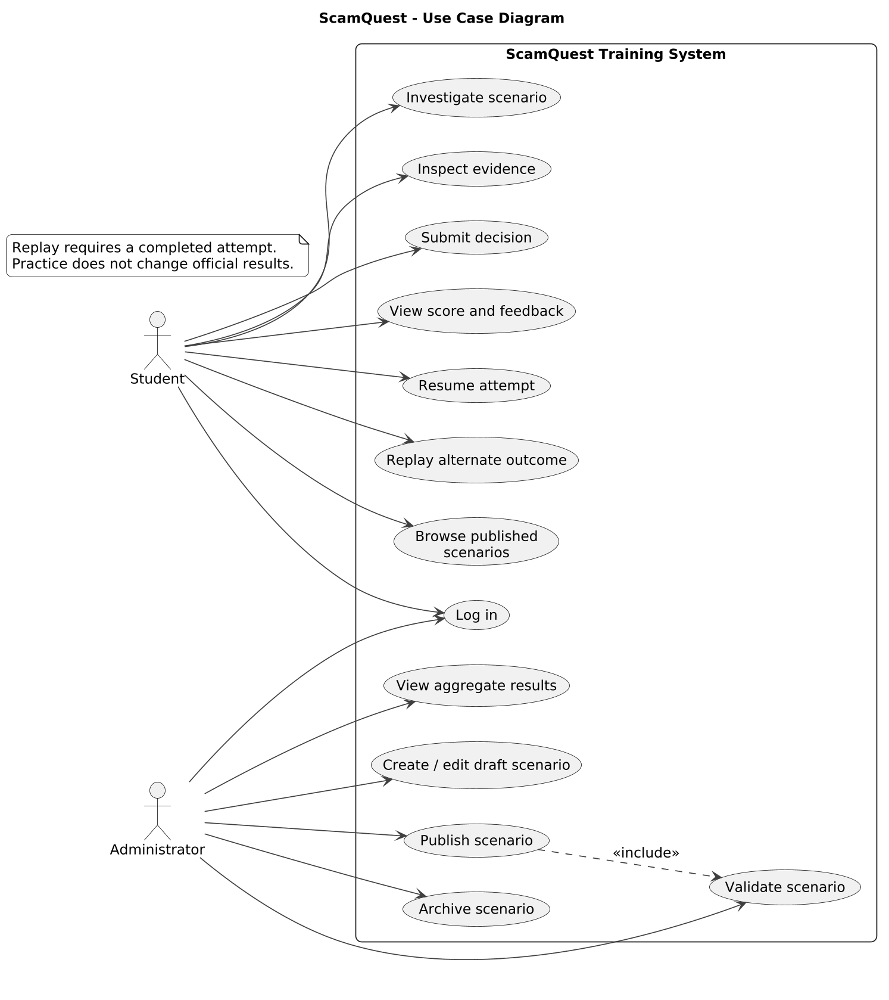
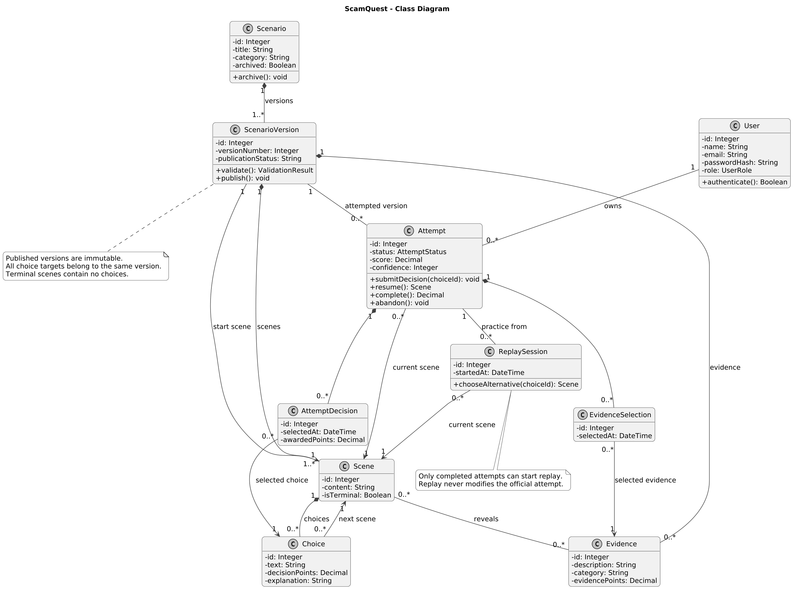
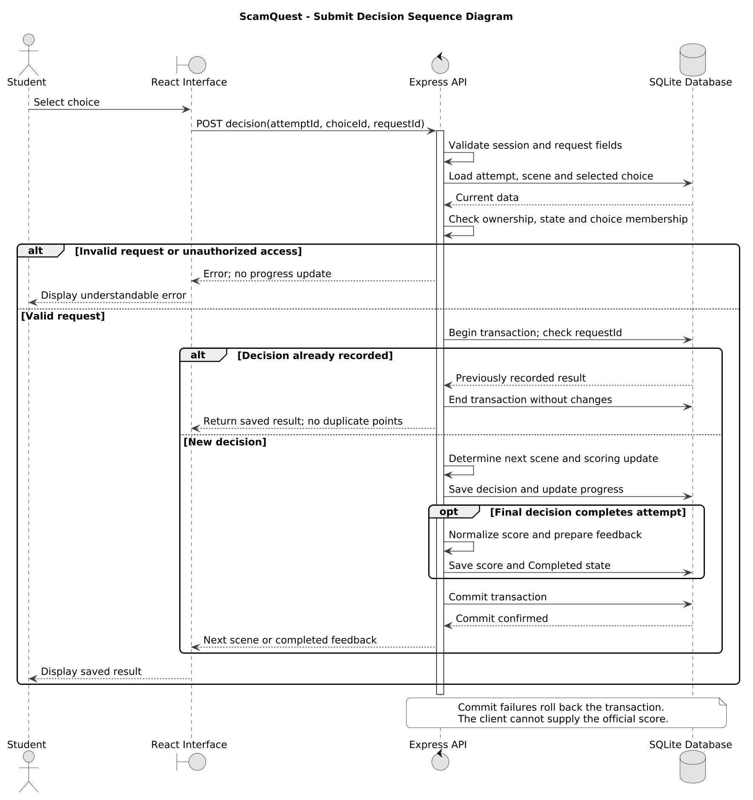
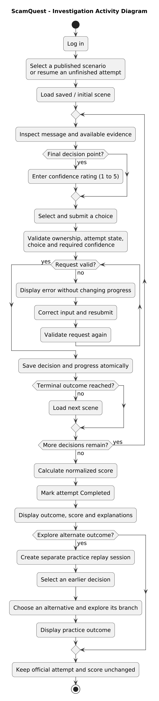
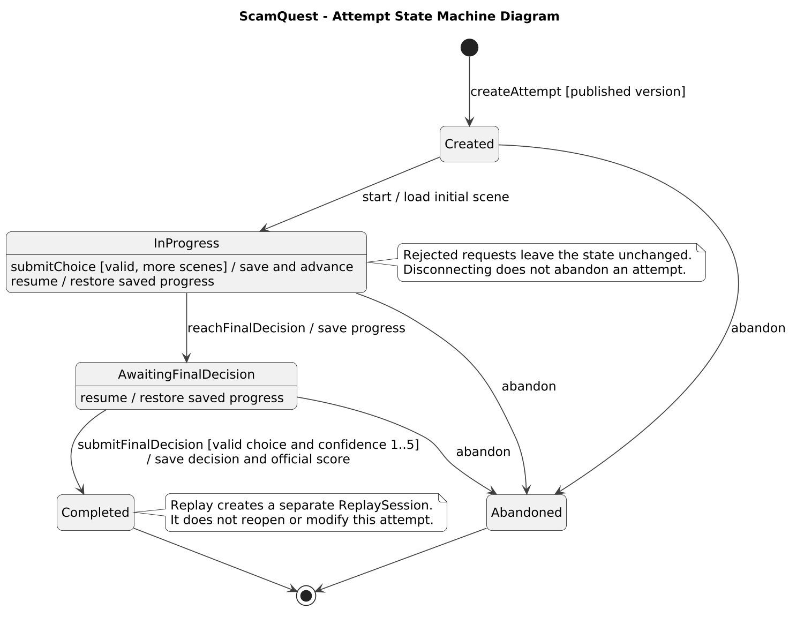

# ScamQuest UML Diagrams

Five UML diagrams for the training-based ScamQuest presentation, with Student and Administrator roles.

These are presentation/design models, not a reverse-engineered guarantee of the current implementation. The class diagram makes evidence selection and replay isolation explicit; implementation may represent them differently.

- **PNG:** images for reports and slides.
- **SVG:** scalable images.
- **PUML:** editable PlantUML source (not native Visual Paradigm `.vpp` files).

## Use Case Diagram

Student and administrator interactions within the ScamQuest system boundary.

[PNG](01_Use_Case.png) | [SVG](01_Use_Case.svg) | [Editable source](01_Use_Case.puml)

## Class Diagram

Proposed domain structure, including scenario versions, recorded evidence and separate replay sessions.

[PNG](02_Class.png) | [SVG](02_Class.svg) | [Editable source](02_Class.puml)

## Sequence Diagram

Decision submission, validation, persistence, duplicate-request handling and feedback.

[PNG](03_Sequence.png) | [SVG](03_Sequence.svg) | [Editable source](03_Sequence.puml)

## Activity Diagram

Investigation workflow, validation, completion and optional alternate replay.

[PNG](04_Activity.png) | [SVG](04_Activity.svg) | [Editable source](04_Activity.puml)

## State Machine Diagram

Attempt lifecycle, abandonment and the separation of practice replay from completed results.

[PNG](05_State_Machine.png) | [SVG](05_State_Machine.svg) | [Editable source](05_State_Machine.puml)

## Related documentation

[Existing UML documentation](../docs/UML.md) · [Existing diagram sources](../docs/diagrams/)
